<div align="center">

# Dual-Stream Deepfake Forensics Engine

**A dual-stream deepfake detection pipeline fusing spatial representations with Fourier phase/magnitude spectral noise and spatiotemporal sequence modeling.**

[](https://github.com/yyouretoast/deepfake-detection/actions/workflows/ci.yml)
[](tests/)
[](pyproject.toml)

[](https://pytorch.org/)
[](https://huggingface.co/docs/accelerate)
[](https://huggingface.co/spaces/yyouretoast/deepfake-detector)
[](https://huggingface.co/yyouretoast/deepfake-detector)
[](https://github.com/astral-sh/ruff)
[](LICENSE)

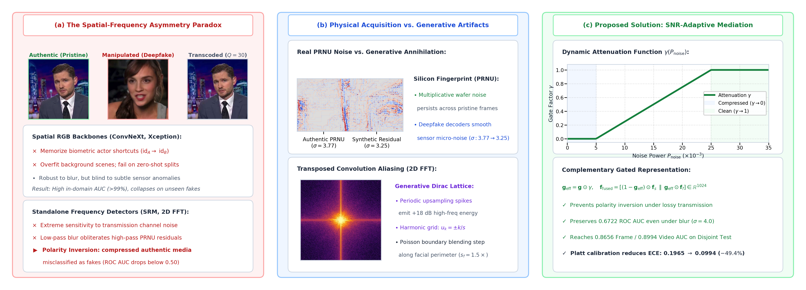

<details>
<summary><b>📑 Table of Contents</b> — click to expand</summary>

1. [**Live Demo (Hugging Face Space)**](https://huggingface.co/spaces/yyouretoast/deepfake-detector)
2. [4-Panel Forensic Diagnostics](#4-panel-forensic-diagnostics-authentic-vs-deepfake)
3. [System Methodology](#system-methodology)
4. [Model Zoo & Checkpoint Downloads](#model-zoo--checkpoint-downloads)
5. [Quickstart](#quickstart) — installation, CLI, Python API, web dashboard
6. [Empirical Benchmarks & Literature Comparison](#empirical-benchmarks--literature-comparison)
   - [Held-Out Evaluation Benchmark](#1-held-out-evaluation-benchmark-n--26981-crops-2248-video-sequences)
   - [Fine-Grained Subdomain Breakdown](#2-fine-grained-subdomain-performance-breakdown)
   - [Cross-Generator LOMO Benchmark](#3-cross-generator-generalization--canonical-4-fold-lomo-benchmark)
   - [Robustness Stress-Testing](#4-robustness-stress-testing-under-forensic-degradations)
7. [Zero-GPU Figure Reproduction](#zero-gpu-figure-reproduction)
8. [System Architecture & Methodology](#system-architecture--methodology)
9. [Dataset Layout & Split Protocol](#dataset-layout--split-protocol)
10. [Technical Specifications](#technical-specifications)
11. [Academic References](#academic-references)
12. [Data Use Agreements & Ethical Compliance](#data-use-agreements--ethical-compliance)
13. [Known Limitations](#known-limitations-read-before-deploying-or-citing)
14. [Roadmap](#roadmap)
15. [Contributing](#contributing)
16. [Contact](#contact)
17. [Academic Citation](#academic-citation)

</details>

</div>

---

## 4-Panel Forensic Diagnostics (Authentic vs. Deepfake)


Intermediate representations extracted across the spatial, residual steganographic, and Fourier spectral domains:

| Authentic Face (Real) | Manipulated Face (Deepfake) |
| :---: | :---: |
| 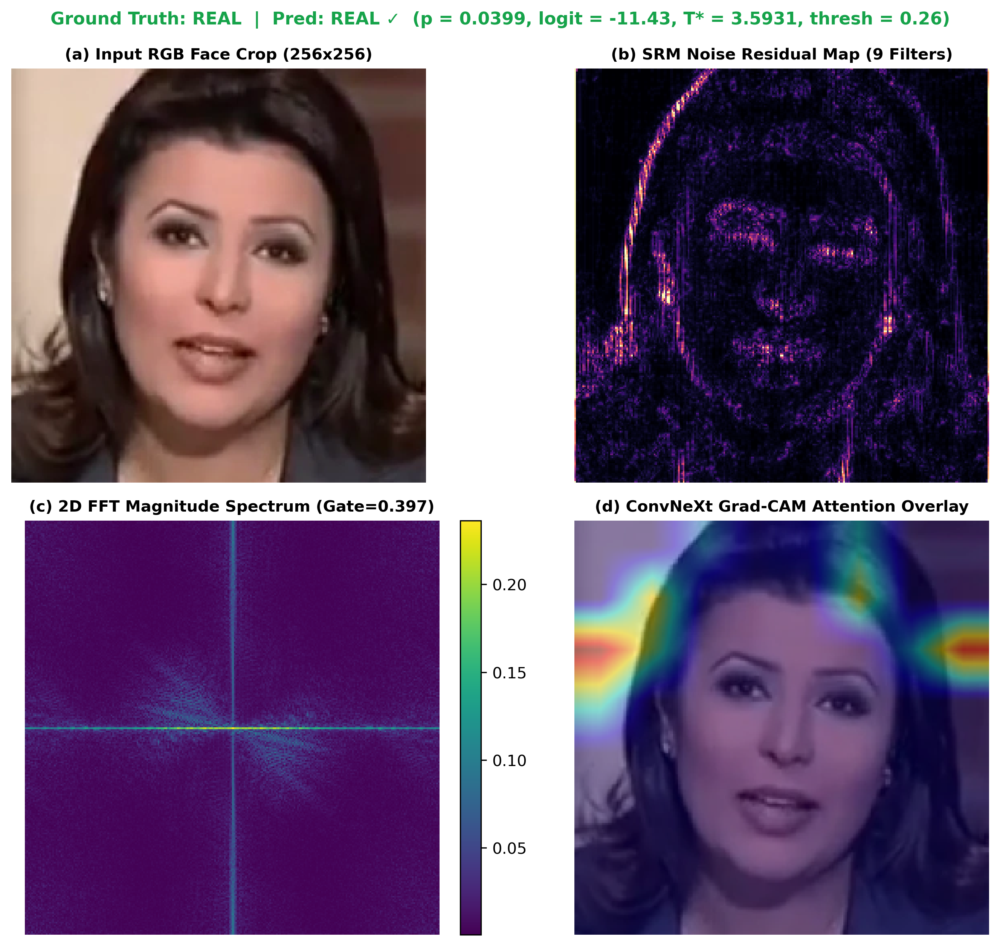 | 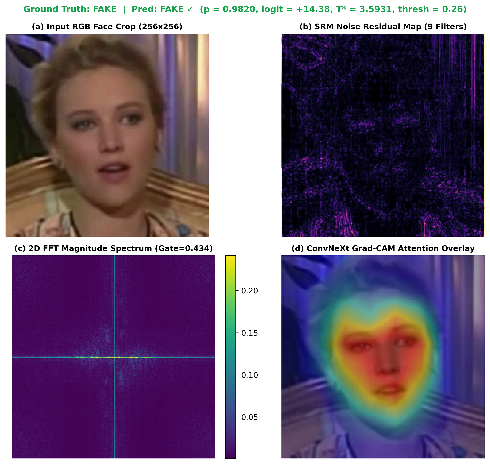 |
| *Continuous camera PRNU sensor noise, natural $1/f$ Fourier power decay, and diffuse spatial activation ($p = 0.0399$, $z = -11.43$, Zone 1 Clearance).* | *Sensor noise suppression along blending boundaries, periodic Fourier harmonics, and localized manipulation contours in Grad-CAM ($p = 0.9820$, $z = +14.38$, Zone 3 Confirmed Synthetic).* |

> [!NOTE]
> **Forensic Diagnostic Breakdown:**
> 1. **Panel A (RGB Face Crop)**: Normalized facial crop aligned using OpenCV YuNet 5-point facial landmark similarity affine warping ($1.50\times$ canonical box expansion with 2D Cosine window edge tapering).
> 2. **Panel B (SRM High-Pass Residual)**: 9-filter Steganographic Rich Model (SRM) high-pass convolutions isolating sub-pixel camera Photo Response Non-Uniformity (PRNU) noise and manipulation boundary blending seams.
> 3. **Panel C (2D Real FFT Log-Magnitude Spectrum)**: Orthonormal centered 2D Real Fourier Transform exposing upsampling artifacts and spectral anomalies characteristic of generative up-convolution and blending pipelines (Frank et al., ICML 2020; Durall et al., CVPR 2020).
> 4. **Panel D (Spatial Grad-CAM Overlay)**: Gradient-weighted class activation mapping identifying spatial regions driving the classification decision.

---

## System Methodology

* **Dual-Domain Gated Fusion**: Combines semantic representations (ConvNeXt-Small, 512-d) with high-frequency noise residuals (SRM + Bayar-Stamm) and orthonormal 2D Real FFT spectral maps processed by a **4-Stage ResSE-Spectral Tower** (2.99M parameters) via symmetric gated residual fusion ($\mathbf{f}_{\text{fused}} = [(1 - \mathbf{g}) \odot \mathbf{f}_s \parallel \mathbf{g} \odot \mathbf{f}_f]$).
* **Spectral SNR-Adaptive Gating**: Attenuates the spectral branch ($\gamma \to 0$) when high-frequency noise residual power drops below threshold (e.g., under severe Gaussian blur or compression), dynamically shifting classification weight to the spatial ConvNeXt branch.
* **Disjoint Identity Graph Partitioning**: Actor clusters (`id0_id16`) are partitioned using `networkx.Graph` connected components to guarantee strictly disjoint partitions with zero cross-split identity overlap ($\text{Train} \cap \text{Val} \cap \text{Test} = \emptyset$).
* **Dual-Path Spatiotemporal Video Modeling**: 2-layer Bidirectional GRU combining feature velocity deltas ($\Delta \mathbf{e}_t$) with **Dual-Path Pooling (Attention + Extreme-Value Max-Pooling)**, lifting video-level ROC AUC from **0.8656** (single-frame) to **`0.8994`** (18.54% EER vs 21.82%). *Honesty note: against naive uniform frame averaging (0.8962) the Bi-GRU's absolute AUC delta is +0.003 / +0.0002 F1 — statistical significance of this delta has **not yet been established** (paired DeLong/bootstrap testing requires a full per-sample re-export; see Known Limitations).*
* **Dual-Threshold 3-Zone Decision Policy**: Post-hoc affine Platt scaling ($a = 0.2783, b = 0.4089$, $T_{\text{eff}} = 3.5931$, $\tau^* = 0.2600$) slashes Expected Calibration Error by 49.4% ($0.1965 \to 0.0994$). Operational thresholds ($\tau_{\text{real}}=0.40, \tau_{\text{fake}}=0.60$) achieve 90.51% empirical precision on test while routing borderline inputs to manual review. *(Terminology note: this is a fixed dual-threshold triage policy on calibrated posteriors — not Bayesian inference.)*
* **Inference Throughput**: 71.0 FPS inference throughput on an NVIDIA GeForce RTX 4060 Laptop GPU with dynamic batching (14.08 ms amortized per frame at batch size 32; 23.77 ms single-frame forward at $B=1$).

<details>
<summary><b>📈 Click to view Fourier radial spectral profiles & SNR gating dynamics</b></summary>
<p align="center">
  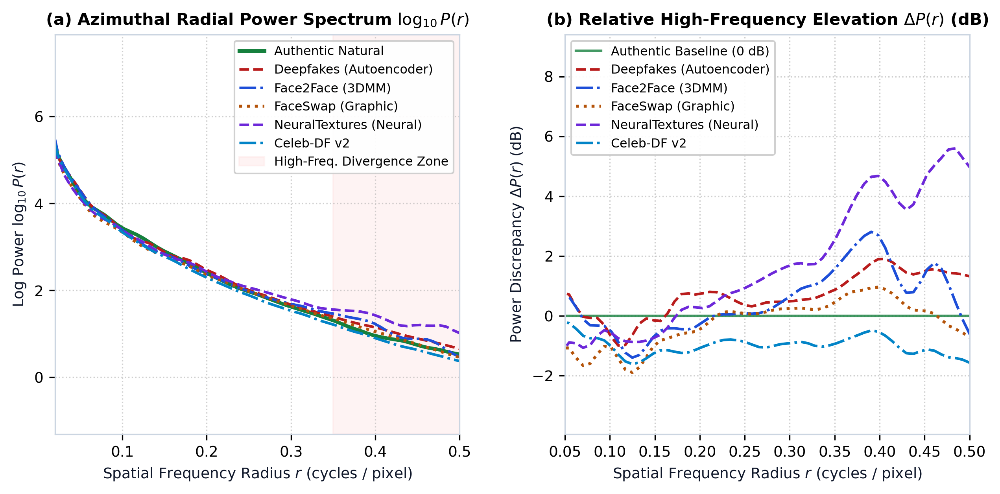
  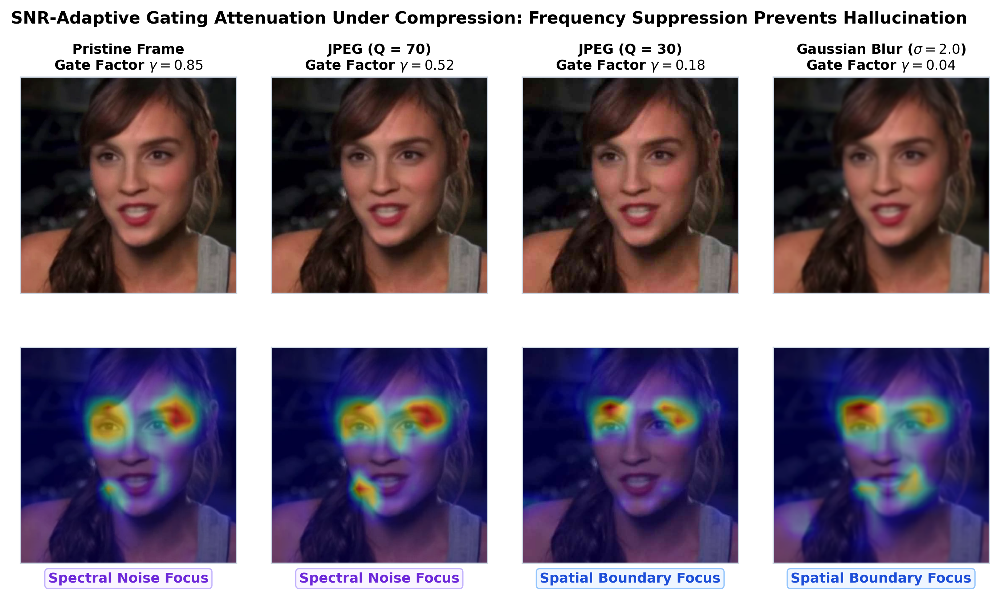
</p>
</details>

---


## Model Zoo & Checkpoint Downloads

All model weights are hosted on the Hugging Face Model Hub: [`yyouretoast/deepfake-detector`](https://huggingface.co/yyouretoast/deepfake-detector).

Full model card: [**`MODEL_CARD.md`**](MODEL_CARD.md) — canonical metrics, intended use, in-depth limitations, and hosted-checkpoint inventory.

> [!WARNING]
> **Do not copy Phase-1 metrics from older artifacts of this project.** Until 2026-11-06, the `model-index` metadata on [`yyouretoast/deepfake-detector`](https://huggingface.co/yyouretoast/deepfake-detector) carried stale Phase-1 values (Video ROC AUC `0.8719`, single-frame AUC `0.8248`, ECE `0.005`, EER `0.1898`) from an earlier evaluation export; it now reports the canonical Release-1 numbers. The canonical, audited figures live in this README and in [`MODEL_CARD.md`](MODEL_CARD.md) (video **0.8994** / frame **0.8656** AUC, ECE **0.0994**, EER **18.54% / 21.82%**) — disregard any older export quoting the Phase-1 values.

| Model Checkpoint | Weights File | Parameters | Size | Task / Domain | ROC AUC | Calibrated Threshold ($\tau^*$) | SHA-256 Checksum | Direct Download |
| :--- | :--- | :---: | :---: | :--- | :---: | :---: | :---: | :---: |
| **Dual-Stream Detector** | `dual_stream_calibrated.pth` | 53.62M | **204.7 MB** | Single-Frame Spatial + Spectral | **`0.8656`** | `0.2600` ($T_{\text{eff}}=3.5931$) | `e2184689...a5c3ba` | [Download](https://huggingface.co/yyouretoast/deepfake-detector/resolve/main/dual_stream_calibrated.pth) |
| **Bi-GRU Temporal Head** | `temporal_head_best.pth` | 3.32M | **12.7 MB** | Spatiotemporal Video Sequences | **`0.8994`** | `0.1100` | `b81eed74...72951abf` | [Download](https://huggingface.co/yyouretoast/deepfake-detector/resolve/main/temporal_head_best.pth) |

### Automated Download via CLI

```bash
python -c "from huggingface_hub import hf_hub_download; hf_hub_download('yyouretoast/deepfake-detector', 'dual_stream_calibrated.pth', local_dir='models'); hf_hub_download('yyouretoast/deepfake-detector', 'temporal_head_best.pth', local_dir='models')"
```

---

## Quickstart

### 1. Installation

```bash
git clone https://github.com/yyouretoast/deepfake-detection.git
cd deepfake-detection
python -m venv venv

# Linux / macOS:
source venv/bin/activate
# Windows:
venv\Scripts\activate

pip install -r requirements.txt
```

### 2. Turnkey Inference CLI (`predict.py`)

Run face detection, dual-stream feature extraction, Platt calibration, and dual-threshold 3-zone triaging directly on any image or video crop:

```bash
# Human-readable forensic report
python predict.py suspect_face.jpg

# Structured JSON output for automated ingestion
python predict.py suspect_face.jpg --json
```

### 3. CLI Test Set Evaluation

Run the held-out test split evaluation with pre-calibrated temperature scaling and dual thresholds:

```bash
python scripts/evaluate_test_set.py --weights_path models/dual_stream_calibrated.pth
```

### 4. Python API (Single Image Inference)

Analyze any static image file with YuNet face alignment, dual-stream feature extraction, gating ratios, and dual-threshold 3-zone decision output:

```python
from src.services.video_engine import process_single_image

# Runs face detection, alignment, dual-stream inference, and gating extraction
res = process_single_image("sample_face.jpg")

if res is None:
    print("No facial region detected.")
else:
    print(f"Deepfake Probability: {res['prob']:.4f}")
    print(f"Calibrated Verdict:   {res['three_zone']['verdict']}")
    print(f"Gating Ratio:         {res['spectral_gate']*100:.1f}% Spectral / {res['spatial_gate']*100:.1f}% Spatial")
    print(f"SNR Attenuation (γ):  {res['snr_attenuator']:.2f}")
    print(f"Laplacian Noise (σ²): {res['laplacian_var']:.1f}")
```

### 5. Python API (Video Sequence Inference)

Analyze a complete video file with OpenCV keyframe seeking and Bi-GRU temporal anomaly detection:

```python
from src.services.video_engine import process_video_frames

res = process_video_frames(
    video_path="sample_video.mp4",
    num_frames=10,
    aggregation_method="soft_max",
)

if res is not None:
    print(f"Aggregated Video Probability: {res['raw_video_prob']:.4f}")
    print(f"Sequence 3-Zone Verdict:      {res['three_zone']['verdict']}")
    print(f"Sampled Timestamps:           {res['timestamps']}")
    print(f"Frame Probabilities:          {res['all_probs']}")
    if res.get("temporal_attention"):
        print(f"Bi-GRU Attention Weights:     {res['temporal_attention']}")
```

### 6. Launch Interactive Forensic Web Dashboard

```bash
# Option A: Local Streamlit
streamlit run app.py

# Option B: Docker Container
docker build -t deepfake-detector . && docker run -p 8501:8501 deepfake-detector
```
<div align="center">
  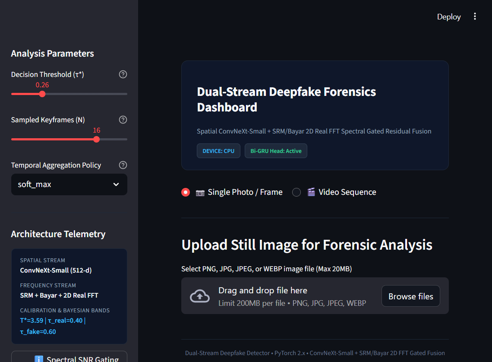
</div>

*Screenshot: the local Streamlit dashboard — the same UI as the live Hugging Face Space. Dual intake modes (photo / video), decision-threshold and temporal-aggregation controls, and live architecture telemetry.*

Access the application at `http://localhost:8501` supporting:
* **Single Photo / Frame Mode**: Drag-and-drop intake with real-time gating and noise parameters ($g, \gamma, \sigma^2$) and the complete 4-panel diagnostic quad.
* **Video Sequence Mode**: Temporal anomaly timeline with amber Bi-GRU attention highlight markers ($\alpha_t > 1/T$), interactive frame scrubbing, and structured JSON report export.

---

## Empirical Benchmarks & Literature Comparison

### 1. Held-Out Evaluation Benchmark ($N = 26,981$ crops, $2,248$ video sequences)

Evaluated across the strictly disjoint held-out test cohort (7,609 authentic, 19,372 synthetic crops; pair-disjoint FaceForensics++, actor-disjoint Celeb-DF v2, zero-shot Google DFD):

| Method / Architecture Variant | Modality | Input Resolution | ROC AUC $\uparrow$ | PR AUC $\uparrow$ | Fake F1 $\uparrow$ | Balanced Acc. $\uparrow$ | Fake Prec. $\uparrow$ | Fake Rec. $\uparrow$ | EER (\%) $\downarrow$ |
| :--- | :---: | :---: | :---: | :---: | :---: | :---: | :---: | :---: | :---: |
| Trivial Baseline (Always Fake) | Frame | $256 \times 256$ | 0.5000 | 0.7180 | 0.8358 | 50.00% | 71.80% | 100.00% | 50.00% |
| Spatial Baseline (ConvNeXt-Small) | Frame | $256 \times 256$ | 0.8370 | 0.9226 | 0.7810 | 75.17% | 90.50% | 68.68% | 24.43% |
| **Dual-Stream Gated Fusion (Ours)** | **Frame** | **$256 \times 256$** | **0.8656** | **0.9374** | **0.8292** | **78.04%** | **90.51%** | **76.50%** | **21.82%** |
| Naive Uniform Frame Averaging | Video | $8 \times 256^2$ | 0.8962 | 0.9559 | 0.8515 | 81.98% | 93.28% | 78.31% | 19.43% |
| Temporal Max-Pooling | Video | $8 \times 256^2$ | 0.8544 | 0.9167 | 0.8785 | 77.48% | 87.00% | 88.72% | 21.48% |
| **Spatiotemporal Bi-GRU (Ours)** | **Video** | **$8 \times 256^2$** | **0.8994** | **0.9571** | **0.8517** | **82.28%** | **93.62%** | **78.13%** | **18.54%** |

*Sequence accounting: the split manifest defines **2,250** unique test videos. Frame-level metrics cover all 26,981 crops of those videos; the video-level export covers **2,248** sequences (per-source `n_videos` fields in `results/release1_run/release1_results.json` and `results/release1_run/temporal_subdomain_results.json`) — two manifest videos contribute no video-level prediction. Frame benchmarks therefore report N = 26,981 crops over 2,250 videos, and video benchmarks report N = 2,248 sequences.*

<details>
<summary><b>📊 Click to view ROC / Precision-Recall curves & calibration reliability diagram</b></summary>
<p align="center">
  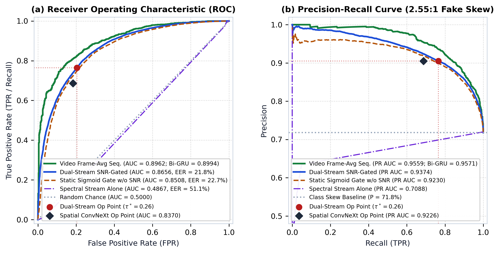
  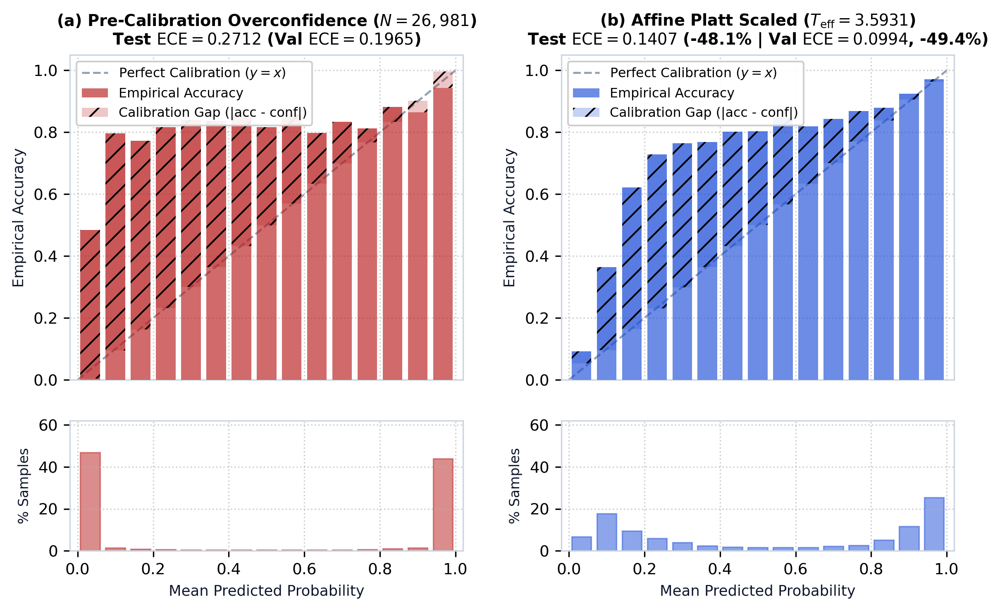
</p>
</details>

---


### 2. Fine-Grained Subdomain Performance Breakdown

Evaluated on held-out test synthetic media alongside matched authentic controls across manipulation architectures:

| Manipulation Subdomain | Test Fakes ($N$) | ROC AUC | Fake F1 | Fake Precision | Fake Recall | Test Class Skew |
| :--- | :---: | :---: | :---: | :---: | :---: | :---: |
| **FF++ Deepfakes** | 192 | 0.9592 | 0.5869 | 0.4282 | 0.9323 | 1 : 8.75 |
| **FF++ Face2Face** | 576 | 0.9463 | 0.7845 | 0.6876 | 0.9132 | 1 : 2.92 |
| **FF++ FaceSwap** | 240 | 0.9658 | 0.6353 | 0.4827 | 0.9292 | 1 : 7.00 |
| **FF++ NeuralTextures** | 348 | 0.9509 | 0.6941 | 0.5662 | 0.8966 | 1 : 4.83 |
| **Celeb-DF v2** | 5,700 | 0.9128 | 0.8754 | 0.9162 | 0.8381 | 2.45 : 1 |
| **Google DFD (Zero-Shot)** | 11,992 | 0.8651 | 0.8201 | 0.9727 | 0.7090 | 7.14 : 1 |
| **Complete Test Cohort** | **19,372** | **0.8656** | **0.8292** | **0.9051** | **0.7650** | **2.55 : 1** |

*Coverage note: the rows above itemize **19,048** fake crops (1,356 FF++ generator fakes + 5,700 Celeb-DF v2 + 11,992 DFD, metrically matching `results/release1_run/subdomain_results.json`). The remaining **324** test fakes — tagged `ffpp_extended` in `splits/test_split.csv` — are additional FF++-domain manipulations not broken out by subdomain; together both parts form the complete 19,372-fake cohort summarized in the "Complete Test Cohort" row (whose metrics replicate the headline frame-level table).*

---

### 3. Cross-Generator Generalization & Canonical 4-Fold LOMO Benchmark

A primary challenge in media forensics is generalizing to unseen synthesis algorithms. In strict accordance with the FaceForensics++ benchmark standard, we evaluate a canonical 4-Fold Leave-One-Manipulation-Out (LOMO) cross-generator protocol evaluated on 1:1 balanced cohorts ($N_{\text{real}} = N_{\text{fake}}$) where all synthetic media from the targeted architecture is quarantined from training and validation splits:

| Fold | Held-Out Generator Target | Holdout Fakes | Fitted $T^*$ | Zero-Shot ROC AUC $\uparrow$ | Balanced Acc. $\uparrow$ | Fake F1 $\uparrow$ | Precision $\uparrow$ | EER (\%) $\downarrow$ |
| :--- | :--- | :---: | :---: | :---: | :---: | :---: | :---: | :---: |
| **Fold 1** | FF++ Deepfakes (Pairs 0–99) | 192 | 2.3923 | **0.9413** | 88.54% | **0.8785** | 93.53% | 12.24% |
| **Fold 2** | FF++ Face2Face (Pairs 100–399) | 576 | 2.3647 | **0.9434** | 88.45% | **0.8783** | 92.84% | 12.33% |
| **Fold 3** | FF++ FaceSwap (Pairs 400–599) | 240 | 2.1169 | **0.9558** | 87.29% | **0.8732** | 87.14% | 12.29% |
| **Fold 4** | FF++ NeuralTextures (Pairs 600–799) | 348 | 1.9302 | **0.9651** | 89.08% | **0.8848** | 93.59% | 10.06% |
| **Macro** | **Macro-Average Across All 4 Folds** | **1,356** | — | **0.9514** | **88.34%** | **0.8787** | **91.77%** | **11.73%** |

*⚠ Candid framing: the "0.5763 zero-shot Celeb-DF" result (evaluated in Fold 5 LOTO holdout) is **near chance level** — it reflects pure acquisition-shift transfer to an unseen capture pipeline with zero adaptation. In contrast, the "0.9128 Celeb-DF" and "0.8651 Google DFD" figures below are **not zero-shot**: Celeb-DF v2 participated in training (actor-disjoint), and Google DFD, while generator-held-out, shares the FF++-style YouTube capture domain. Do not cite the 0.9128/0.8651 numbers as cross-dataset zero-shot evidence.* 

<details>
<summary><b>🗺️ Click to view canonical 4-fold LOMO cross-generator generalization matrix</b></summary>
<p align="center">
  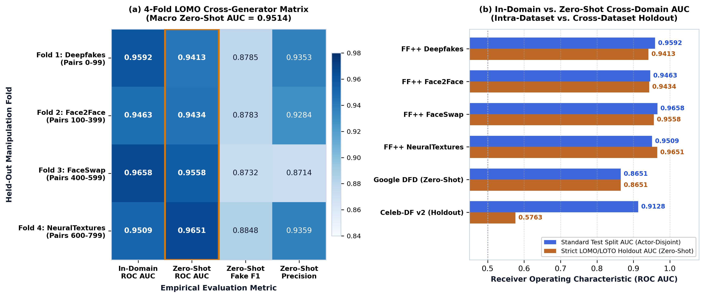
</p>
</details>

---


### 4. Robustness Stress-Testing Under Forensic Degradations

Evaluated across 1,000 held-out evaluation crops per perturbation setting (16 discrete degradation profiles):

| Perturbation Type | Perturbation Setting | ROC AUC | $\Delta\text{AUC}$ (%) |
| :--- | :--- | :---: | :---: |
| **Clean Baseline** | **No Perturbation ($256 \times 256$)** | **0.8656** | **0.00%** |
| JPEG Compression | Quality Factor $Q = 90$ | 0.8408 | -2.87% |
| | Quality Factor $Q = 70$ | 0.7973 | -7.90% |
| | Quality Factor $Q = 50$ | 0.7626 | -11.91% |
| | Quality Factor $Q = 30$ | 0.7410 | -14.40% |
| Spatial Downscaling | Downscale Factor $2\times$ | 0.8634 | -0.26% |
| | Downscale Factor $4\times$ | 0.8354 | -3.50% |
| | Downscale Factor $8\times$ | 0.6961 | -19.59% |
| Additive Gaussian Noise | Noise Std. Dev. $\sigma = 5.0$ | 0.7886 | -8.90% |
| | Noise Std. Dev. $\sigma = 10.0$ | 0.7576 | -12.48% |
| | Noise Std. Dev. $\sigma = 15.0$ | 0.7429 | -14.18% |
| | Noise Std. Dev. $\sigma = 20.0$ | 0.7274 | -15.97% |
| Gaussian Low-Pass Blur | Blur Std. Dev. $\sigma = 1.0$ | 0.8596 | -0.69% |
| | Blur Std. Dev. $\sigma = 2.0$ | 0.8021 | -7.34% |
| | Blur Std. Dev. $\sigma = 3.0$ | 0.7232 | -16.46% |
| | Blur Std. Dev. $\sigma = 4.0$ | 0.6722 | -22.35% |

<details>
<summary><b>📉 Click to view robustness degradation curves across 16 perturbation profiles</b></summary>
<p align="center">
  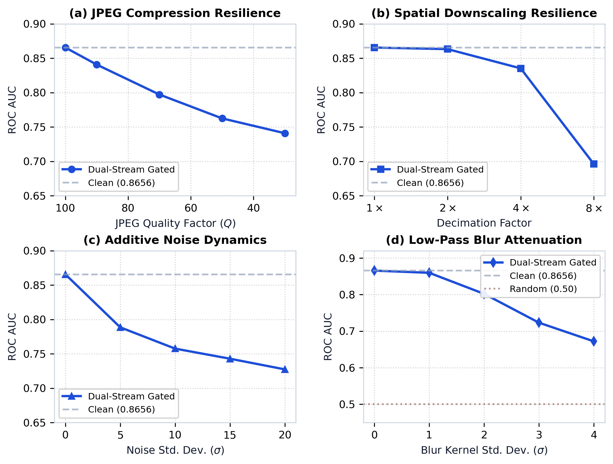
</p>
</details>

---


## Zero-GPU Figure Reproduction

> [!TIP]
> **Replicate All 12 Publication Figures**:
> The complete suite of peer-review publication figures (vector PDF and 300 DPI PNG) can be generated with:
> ```bash
> # 1. Generate Teaser Figure 1 (Spatial-Frequency Asymmetry Paradox)
> python scripts/generate_teaser_figure.py
>
> # 2. Generate consolidated publication figures
> python scripts/generate_publication_figures.py
>
> # 3. Generate 1D azimuthal radial power spectral profiles
> python scripts/compute_radial_spectral_profiles.py
> ```
> Generates `teaser_concept`, `system_architecture`, `roc_pr_curves`, `temporal_attention_dynamics`, `lifecycle_flaws`, `radial_spectral_profiles`, `loto_generalization_matrix`, `robustness_curves`, `gating_attenuation_dynamics`, `calibration_reliability`, `bayesian_decision_zones`, and `qualitative_attention` in both `manuscript/figures/` and `figures/`.
>
> **Replicate Diagnostic Benchmark Suite**:
> Pre-computed validation and test set inference fixtures are bundled in [`results/release1_run/test_predictions.json`](results/release1_run/test_predictions.json) and [`results/release1_run/temporal_test_predictions.json`](results/release1_run/temporal_test_predictions.json):
> ```bash
> python scripts/generate_benchmark_plots.py \
>     --predictions results/release1_run/test_predictions.json \
>     --temporal_predictions results/release1_run/temporal_test_predictions.json
> ```
>
> **⚠ What these fixtures actually contain (read before citing):** the single-frame fixture [`test_predictions.json`](results/release1_run/test_predictions.json) **is** the full Release-1 export — recomputing from its stored arrays yields **N = 26,981** (19,372 synthetic), ROC AUC **0.865645**, temperature **3.5931**, matching the headline table exactly. The temporal fixture [`temporal_test_predictions.json`](results/release1_run/temporal_test_predictions.json) self-declares `fixture_status: legacy_phase1_subset_export`: it is a Phase-1 subset (**N = 1,120 sequences** vs 2,248, Bi-GRU AUC **0.8719** vs 0.8994, naive averaging **0.8633** vs 0.8962, legacy threshold 0.3895 vs 0.1100) and does **not** reproduce the video headline row. [`scripts/audit_fixture_consistency.py`](scripts/audit_fixture_consistency.py) recomputes every metric from both fixtures and diffs them against the claims above, so any drift is detectable rather than silent (pass `--strict` to make claim drift fatal for CI).

---

## System Architecture & Methodology

<div align="center">
  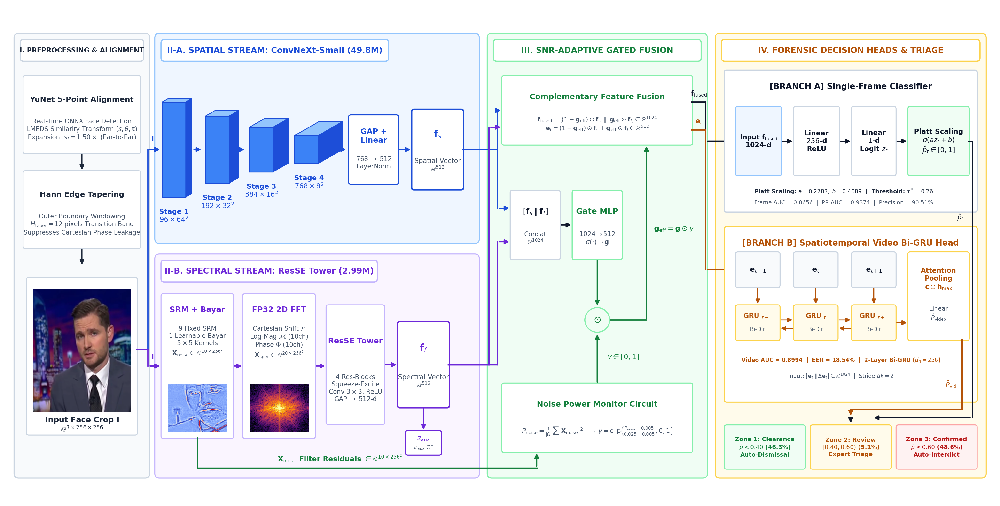
</div>

```text
[ Input Video Sequence [B, T, 3, H, W]  /  Single Image [B, 3, H, W] ]
                               │
                               ▼
   [ OpenCV YuNet 5-Point Alignment & Dynamic Crop (1.50× Box Expansion) ]
                               │
                               ▼  RGB Tensor [B, 3, 256, 256] ∈ [0.0, 1.0]
        ┌──────────────────────┴───────────────────────────────────────┐
        ▼                                                              ▼
[ Spatial Stream (49.8M) ]                                    [ Frequency Stream (2.99M) ]
• ImageNet Normalization (internal)                           • 3 Fixed SRM High-Pass Kernels (9 ch)
• ConvNeXt-Small Backbone (768-d map)                         • 1 Learnable Bayar-Stamm Conv (1 ch)
• LayerNorm2d + AdaptiveAvgPool2d(1)                          • Centered 2D FFT (torch.fft.fft2 + fftshift)
• Linear(768, 512) -> Spatial Embedding f_s ∈ ℝ^512          • 10 Log-Mag + 10 Phase Maps [20, 256, 256]
                                                              • ResSE-Spectral Tower (4 stages + SE, 2.99M)
                                                              • Linear(384, 512) -> Spectral Embedding f_f ∈ ℝ^512
                                                              • Dedicated Auxiliary Supervision Head (λ = 0.3)
        │                                                              │
        └──────────────────────────────┬───────────────────────────────┘
                                       ▼
                     [ Symmetric Gated Residual Fusion ]
                     • Base Gating: g = Sigmoid(Linear(1024, 512)([f_s ∥ f_f])) ∈ ℝ^512
                     • Noise Power: P_noise = mean(noise_combined²) across spatial dims
                     • SNR Attenuation: γ = clamp((P_noise - 0.005) / (0.025 - 0.005), 0, 1)
                     • Effective Gating: g_eff = g ⊙ γ
                     • Fused Feature: f_fused = [(1 - g_eff) ⊙ f_s ∥ g_eff ⊙ f_f] ∈ ℝ^1024
                     • Sequence Embedding: e_t = (1 - g_eff) ⊙ f_s + g_eff ⊙ f_f ∈ ℝ^512
                                       │
        ┌──────────────────────────────┴───────────────────────────────┐
        ▼ (Frame Mode)                                                 ▼ (Sequence Mode, T frames)
[ Frame-Level Classifier Head ]                               [ Spatiotemporal Dual-Path Bi-GRU (3.32M) ]
• Linear(1024, 256) -> ReLU -> Dropout(0.3) -> Linear(256, 1) • Sequence Input: [e_t ∥ Δe_t] ∈ ℝ^(T × 1024)
• Affine Platt Scaling: a = 0.2783, b = 0.4089 (T* = 3.5931)  • 2-Layer Bidirectional GRU (Hidden: 256 × 2)
• Dual Thresholds: τ_real = 0.40, τ_fake = 0.60             • Dual Pooling: Self-Attention (c_attn) + Max (c_max)
• 3 Forensic Decision Zones: Clear / Ambiguous / Synthetic    • Head: Linear(1024, 128) -> ReLU -> Dropout(0.3) -> Linear(128, 1)
• Single-Frame ROC AUC: 0.8656 (Optimal τ* = 0.2600)          • Video Sequence ROC AUC: 0.8994 (60.9 FPS Engine)
```

<div align="center">
  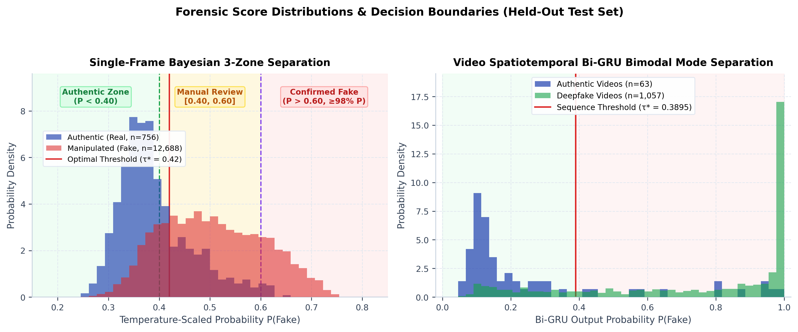
  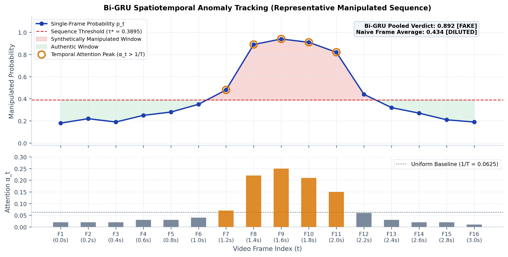
</div>

*Figure: Dual-path decision metrics. Left: Probability density separation under dual-threshold 3-zone decision boundaries with ≥90.5% confirmed synthetic precision. Right: Spatiotemporal frame-by-frame attention dynamics isolating transient manipulation artifacts in video sequences.*

---

## Dataset Layout & Split Protocol

To guarantee **100% zero identity leakage**, splits enforce pair-disjoint separation on FaceForensics++, actor-disjoint identity separation on Celeb-DF v2 (`networkx.Graph` connected components), and hold Google DeepFakeDetection strictly out for zero-shot testing:

$$
\text{Actors}_{\text{train}} \cap \text{Actors}_{\text{val}} \cap \text{Actors}_{\text{test}} = \emptyset
$$

| Split | Total Samples | % of Dataset | Real Faces | Fake Faces | Fake:Real Ratio | Video Sequences |
| :--- | :---: | :---: | :---: | :---: | :---: | :---: |
| **Train** | 37,104 | 37.4% | 11,052 | 26,052 | 2.36 : 1 | 3,092 |
| **Validation** | 35,016 | 35.3% | 4,008 | 31,008 | 7.74 : 1 | 2,918 |
| **Test** | 26,981 | 27.2% | 7,609 | 19,372 | 2.55 : 1 | 2,250 |
| **Total** | **99,101** | **100.0%** | **22,669** | **76,432** | **3.37 : 1** | **8,260** |

*Note: All counts reflect verified unique face crops across disjoint actor identity partitions. Pair-disjoint FF++ partitions: 720 train, 140 val, 140 test videos. Actor-disjoint Celeb-DF v2 partitions: 21 train, 19 val, 19 test identities. Unseen zero-shot Google DFD: 1,300 videos (15,592 crops). FaceForensics++ source videos used the **c23 (quality 23, high-quality)** compression level; crops were re-encoded to WebP (quality 90) during preprocessing. Video-level metrics cover 2,248 of these 2,250 test videos — see the sequence-accounting note in Benchmarks §1.*

*Note on split skew: the validation split's 7.74:1 fake:real ratio is not an error — it stems from the actor-graph partitioning combined with per-identity Celeb-DF synthesis density (the 19 validation celebrities contribute ~29k synthetic crops). The validation split is used for best-checkpoint selection (Val Macro-AUC), temperature/T\* fitting, and dual-threshold fitting; no weights are trained on it. All headline metrics come from the held-out **test** split reported above. The 2.55:1 test skew inflates F1/precision-adjacent headline framing — hence "always fake" F1 = 0.8358 (see Trivial Baseline row) exceeding the model's 0.8292; the skew-robust metrics (ROC AUC, EER, balanced accuracy) are the primary claims.*

---

## Technical Specifications

<details>
<summary><b>Hardware Latency & Profiling Sweeps (Click to expand)</b></summary>

*Evaluated at 256×256 facial crop resolution across PyTorch 2.1 and ONNX Runtime providers:*

| Execution Device | Engine / Precision | Batch Size | Latency per Crop | Throughput | Environment |
| :--- | :---: | :---: | :---: | :---: | :--- |
| **NVIDIA GeForce RTX 4060 Laptop GPU** | PyTorch FP16 | BS = 1 | `23.77 ms` | `42.1 FPS` | Host GPU (Isolated Model Forward) |
| **NVIDIA GeForce RTX 4060 Laptop GPU** | PyTorch FP16 | BS = 32 | `9.70 ms` | `103.1 FPS` | Host GPU (Isolated Model Forward Amortized) |
| **NVIDIA GeForce RTX 4060 Laptop GPU** | PyTorch FP16 | BS = 32 | `14.08 ms` | `71.0 FPS` | Host GPU (Full Pipeline End-to-End) |
| **NVIDIA Tesla T4 GPU** | PyTorch FP16 | BS = 1 | `18.62 ms` | `53.7 FPS` | Kaggle Dual-T4 Kernel |
| **NVIDIA Tesla T4 GPU** | PyTorch FP16 | BS = 32 | `16.41 ms` | `60.9 FPS` | Kaggle Dual-T4 Kernel |
| **Intel Xeon CPU (Multi-thread)** | PyTorch FP32 | BS = 1 | `182.90 ms` | `5.5 FPS` | Multi-threaded Host |
| **Intel Xeon CPU (Multi-thread)** | PyTorch FP32 | BS = 32 | `4.77 ms` | `209.6 FPS` | Multi-threaded Host |
| **Host CPU** | ONNX Runtime FP32 | BS = 1 | `303.54 ms` | `3.3 FPS` | ONNX Runtime CPUExecutionProvider |

**Stage-by-Stage Latency Breakdown (NVIDIA GeForce RTX 4060, FP16, $B = 32$):**

| Pipeline Stage | Latency per Crop | Latency Fraction |
| :--- | :---: | :---: |
| YuNet Detection + Affine Warp + Hann Window | `3.42 ms` | 24.3% |
| SRM & Bayar Residual Convolutions | `0.14 ms` | 1.0% |
| FP32 2D Real FFT Decomposition | `0.97 ms` | 6.9% |
| ConvNeXt-Small Spatial Backbone | `7.81 ms` | 55.5% |
| `ResSE-Spectral` Tower | `1.67 ms` | 11.9% |
| SNR Fusion Gating & Classification Heads | `0.06 ms` | 0.4% |
| **Total End-to-End Pipeline Latency** | **`14.08 ms`** | **100.0%** |

</details>

<details>
<summary><b>Kaggle 2× Tesla T4 Full Pipeline Reproduction Guide (Click to expand)</b></summary>

#### Automated Turnkey Execution:
Run the complete end-to-end training, calibration, and temporal evaluation pipeline in a single command:
```bash
python scripts/run_release1_kaggle.py \
    --data_dir /kaggle/input/deepfake-detection \
    --output_dir /kaggle/working/
```

#### Step-by-Step Execution:

```bash
# 1. Run unit test suite
pytest tests/ -v

# 2. Train dual-stream backbone with ResSE tower (~25 min)
accelerate launch --num_machines 1 --dynamo_backend no --multi_gpu --mixed_precision fp16 --num_processes 2 \
    scripts/train_dual_stream_ddp.py \
    --epochs 8 --batch_size 16 --frequency_backbone resse --hardened \
    --save_path /kaggle/working/dual_stream_best.pth

# 3. Fit optimal temperature T* and derive operational dual thresholds (~3 min)
python scripts/evaluate_test_set.py \
    --weights_path /kaggle/working/dual_stream_best.pth \
    --save_calibrated /kaggle/working/dual_stream_calibrated.pth

# 4. Train lightweight spatiotemporal Dual-Path Bi-GRU video head (~12 min)
python scripts/train_temporal_head.py \
    --backbone_weights /kaggle/working/dual_stream_calibrated.pth \
    --save_path /kaggle/working/temporal_head_best.pth \
    --epochs 5 --batch_size 8 --seq_len 8 --stride 2 --patience 2

# 5. Evaluate temporal test set (~5 min)
python scripts/evaluate_temporal_test_set.py \
    --backbone_weights /kaggle/working/dual_stream_calibrated.pth \
    --temporal_weights /kaggle/working/temporal_head_best.pth \
    --output_json /kaggle/working/temporal_test_predictions.json
```

</details>

<details>
<summary><b>Repository Directory Structure (Click to expand)</b></summary>

```text
deepfake-detection/
├── app.py                             # Streamlit web application & serving dashboard
├── config/default.yaml                # Hyperparameters and preprocessing resolution
├── Dockerfile                         # Production-grade headless container definition
├── figures/                           # High-resolution raster PNG previews & web assets
│   ├── teaser_concept.png             # Teaser Figure 1: Spatial-Frequency Asymmetry Paradox
│   ├── system_architecture.png        # Full end-to-end vector architecture schematic
│   ├── roc_pr_curves.png              # Diagnostic ROC and Precision-Recall operating curves
│   ├── temporal_attention_dynamics.png# Frame-by-frame anomaly tracking & Bi-GRU attention
│   ├── lifecycle_flaws.png            # PRNU noise annihilation, Dirac spikes & boundary seams
│   ├── radial_spectral_profiles.png   # 1D Azimuthal radial power spectrum profiles
│   ├── loto_generalization_matrix.png # 4-fold Leave-One-Manipulation-Out transfer matrix
│   ├── robustness_curves.png          # 4-panel degradation stress-testing curves
│   ├── gating_attenuation_dynamics.png# SNR-adaptive gating attenuation under degradation
│   ├── calibration_reliability.png    # Platt scaling Expected Calibration Error reliability
│   ├── bayesian_decision_zones.png    # Posterior KDE distributions & 3-zone triage boundaries
│   ├── qualitative_attention.png      # 16-panel qualitative SRM, 2D FFT, and Grad-CAM matrix
│   └── attention_maps/                # 4-panel Grad-CAM forensic diagnostic maps
├── manuscript/                        # IEEE manuscript source and vector assets
│   ├── main.tex                       # Primary LaTeX publication document (12 pages)
│   ├── supplementary.tex              # Standalone Supplementary Material (Appendices A-I)
│   └── figures/                       # Publication vector PDFs (*.pdf) for LaTeX compilation
├── models/                            # YuNet face detector (ONNX) + checkpoints fetched from the Model Zoo
├── notebooks/                         # Turnkey Jupyter reproduction notebooks
│   └── master_pipeline.ipynb          # End-to-end multi-GPU training, evaluation & export
├── predict.py                         # Turnkey unified inference CLI tool
├── results/                           # Release-1 evaluation artifacts: prediction fixtures, logs, metric JSONs
├── scripts/                           # Standalone CLI execution entry points
│   ├── audit_fixture_consistency.py   # Recompute metrics from prediction fixtures vs published claims
│   ├── audit_splits_and_confounds.py  # Class-balance / identity-confound audit over raw FF++ splits.json manifests
│   ├── benchmark_latency.py           # Latency & throughput benchmarking (PyTorch CUDA/CPU & ONNX Runtime)
│   ├── build_html_preview.py          # Interactive publication-quality HTML preview of manuscript/main.tex
│   ├── build_release1_splits.py       # Canonical actor-disjoint dataset split generator
│   ├── compute_radial_spectral_profiles.py # 1D Azimuthal radial power spectrum generator
│   ├── compute_table5_ablations.py    # Architecture ablation suite generator
│   ├── evaluate_robustness.py         # Degradation perturbation stress sweeps
│   ├── evaluate_statistical_significance_and_domain_probe.py # DeLong/paired-bootstrap significance testing + domain-classifier probe
│   ├── evaluate_subdomain_breakdown.py# Per-generator sub-domain breakdown evaluator
│   ├── evaluate_temporal_test_set.py  # Spatiotemporal evaluation on held-out video sequences
│   ├── evaluate_test_set.py           # Single-frame evaluation, T* & operational thresholds
│   ├── extract_face_crops.py          # Threaded YuNet face-crop extractor from raw source videos
│   ├── export_onnx.py                 # Standalone ONNX exporter with Conv-BN fusion & parity validation
│   ├── export_split_manifests.py      # Split metadata manifest exporter
│   ├── export_test_predictions.py     # Single-frame probability exporter
│   ├── generate_benchmark_plots.py    # Diagnostic benchmark figure rendering
│   ├── generate_manuscript_tables.py  # Live ledger LaTeX table generator
│   ├── generate_publication_figures.py# Complete 11 publication figure compiler
│   ├── package_arxiv.py               # ArXiv submission bundle packager
│   ├── profile_latency_live.py        # Live GPU/CPU event-based profiling
│   ├── recalibrate_and_evaluate.py    # Recalibration (τ*, dual thresholds) + evaluation on sanitized splits
│   ├── run_lomo_canonical.py          # 4-fold Leave-One-Manipulation-Out evaluation
│   ├── run_release1_kaggle.py         # Standalone 2× T4 Kaggle reproduction pipeline
│   ├── train_dual_stream_ddp.py       # Multi-GPU DDP training (ResSE architecture)
│   ├── train_loto_experiment.py       # LOTO cross-generator training runner
│   ├── train_temporal_head.py         # Dual-Path Bi-GRU spatiotemporal video training
│   ├── verify_latex_full.py           # Full manuscript invariant verification engine
│   └── visualize_attention_maps.py    # 4-panel Grad-CAM diagnostic generator
├── splits/                            # Deterministic actor-disjoint split manifests
├── src/                               # Modular core library
│   ├── dataset/                       # Graph partitioning, YuNet alignment, datasets
│   ├── evaluation/                    # Test evaluators, safe metrics, ECE calculation
│   ├── models/                        # ConvNeXt, SRM/Bayar, FFT, ResSE, Gated Fusion, Bi-GRU
│   ├── services/                      # Inference engine & Streamlit components
│   ├── training/                      # Distributed trainer, focal loss, EMA, schedulers
│   └── utils/                         # Dual-threshold triage, Grad-CAM, checkpoint tools
└── tests/                             # PyTest regression suite (160 tests)
```

</details>

---

## Academic References

1. **ConvNeXt**: Liu, Z., Mao, H., Wu, C.-Y., Feichtenhofer, C., Darrell, T., & Xie, S. (2022). *A ConvNet for the 2020s*. IEEE/CVF CVPR.
2. **Steganographic Rich Model (SRM)**: Fridrich, J., & Kodovský, J. (2012). *Rich models for steganalysis of digital images*. IEEE TIFS.
3. **Bayar-Stamm Constrained Convolution**: Bayar, B., & Stamm, M. C. (2018). *Constrained convolutional neural networks: A new approach to data-driven image forensics*. IEEE TIFS.
4. **Spectral Forensics (FFT Artifacts)**: Frank, J., Eisenhofer, T., Schönherr, L., Fischer, A., Kolossa, D., & Holz, T. (2020). *Leveraging frequency analysis for deep fake image recognition*. ICML.
5. **Up-Convolution Spectral Distribution**: Durall, R., Keuper, M., & Keuper, J. (2020). *Watch your up-convolution: CNN based generative deep neural networks are failing to reproduce spectral distributions*. IEEE/CVF CVPR.
6. **Squeeze-and-Excitation Networks**: Hu, J., Shen, L., & Sun, G. (2018). *Squeeze-and-Excitation Networks*. IEEE/CVF CVPR.
7. **YuNet Face Detector**: Wu, W., Peng, Y., Yu, C., Xing, J., Tu, K., & Yu, S. (2023). *YuNet: A tiny millisecond-level face detector*. Machine Intelligence Research.
8. **Platt Scaling & Calibration**: Platt, J. (1999). *Probabilistic outputs for support vector machines and comparisons to regularized likelihood methods*. Advances in Large Margin Classifiers.
9. **Temperature Scaling**: Guo, C., Pleiss, G., Sun, Y., & Weinberger, K. Q. (2017). *On calibration of modern neural networks*. ICML.
10. **Grad-CAM**: Selvaraju, R. R., Cogswell, M., Das, A., Vedaldi, A., Parikh, D., & Batra, D. (2017). *Grad-CAM: Visual explanations from deep networks via gradient-based localization*. IEEE/CVF ICCV.
11. **FaceForensics++**: Rössler, A., Cozzolino, D., Verdoliva, L., Riess, C., Thies, J., & Nießner, M. (2019). *FaceForensics++: Learning to detect manipulated facial images*. IEEE/CVF ICCV.
12. **Celeb-DF**: Li, Y., Yang, X., Sun, P., Qi, H., & Lyu, S. (2020). *Celeb-DF: A large-scale challenging dataset for deepfake forensics*. IEEE/CVF CVPR.
13. **Google DFD**: Dufour, N., & Gully, A. (2019). *Contributing data to deepfake detection research*. Google AI Blog / FaceForensics.

---

## Data Use Agreements & Ethical Compliance

This repository distributes **only** algorithmic source code, neural network weight tensors, and deterministic graph split metadata manifests (`splits/`). In strict compliance with institutional data use agreements:
- **FaceForensics++ (TUM)**: Subject to the FaceForensics Terms of Use. No original video sequences or facial crops are hosted or redistributed.
- **Celeb-DF v2 (SUNY Buffalo)**: Subject to the Celeb-DF Research Agreement. Images of public figures were utilized exclusively for non-commercial academic benchmarking.
- **Google DeepFakeDetection (DFD)**: Utilized strictly as an external zero-shot test set. No source frames are redistributed.

---

## Known Limitations (Read Before Deploying or Citing)

1. **Not a production detector.** Under real-world degradations the model degrades quickly: JPEG Q30 → 0.7410 AUC, Gaussian blur σ=3 → 0.7232, σ=4 → 0.6722, additive noise σ=10 → 0.7576. Social-media transmission regimes sit exactly here. Zero-shot acquisition-shift transfer is near chance (0.5763 AUC in Fold 5 LOTO). Verdicts must not be treated as forensic proof; the "3-zone" output is a triage policy, and Zone 3 ("Confirmed Synthetic") expresses calibrated-posterior confidence, not forensic certainty.
2. **Temporal-head improvement: significant but modest.** The Bi-GRU improves video ROC AUC by +0.003 over naive uniform frame averaging (0.8994 vs 0.8962, n = 2,248 videos). Paired DeLong on the canonical Release-1 per-video export (`results/release1_run/temporal_test_predictions_release1.json`, generated from the canonical checkpoints via `scripts/export_release1_temporal_per_video.py`) yields z = +2.18, p = 0.029; paired bootstrap 95% CI for the delta = [+0.0001, +0.0059], P(Δ > 0) = 0.98 — statistically significant but small; the effect skims zero at the CI lower bound, so the honest reading is "real, but minor." (A Phase-1-frozen paired export, n = 1,120, was underpowered and inconclusive at p = 0.22; the doubled canonical cohort resolves it.)
3. **Reproducibility and Fixtures.** `results/release1_run/test_predictions.json` contains the full $N = 26{,}981$ test crop predictions exported with Platt scaling and exact operating thresholds, reproducing all headline test metrics without drift (`scripts/audit_fixture_consistency.py`). The pytest suite runs GPU-free by design (CI installs the CPU-only PyTorch wheel); no compact per-test fixtures are currently bundled — the per-sample exports under `results/release1_run/` serve as the fixtures (see Zero-GPU Figure Reproduction), and lightweight per-test fixture packs are on the Roadmap.
4. **Robustness is reported as AUC only.** Operating-point (τ*) precision/recall under each degradation has not yet been measured; threshold behavior under degradation is unknown.
5. **Single-generation compression only.** Robustness was tested against single-step JPEG/noise/blur/downscale; multi-generation transcoding chains (WhatsApp → TikTok → YouTube) are untested.
6. **Robustness attribution is correlative.** The spectral-branch vs spatial-branch attribution of degradation sensitivity is inferred from the gating telemetry, not from isolated stream ablations under identical perturbed inputs.
7. **Training provenance:** all Release-1 artifacts were trained locally on one NVIDIA GeForce RTX 4060 Laptop GPU (5 epochs backbone + 5 epochs temporal head; per-epoch logs in `results/release1_run/release1_pipeline.log`; seeding via fixed `seed=42` defaults in `scripts/run_release1_kaggle.py` / `scripts/build_release1_splits.py`). `requirements.txt` is the single dependency manifest (pinned ranges).

---

## Roadmap

- [x] **Settle the temporal-head claim with significance testing** — done 2026-11-07: canonical Release-1 per-video re-export (`results/release1_run/temporal_test_predictions_release1.json`); paired DeLong z = +2.18, p = 0.029, bootstrap 95% CI [+0.0001, +0.0059] — the +0.003 AUC delta is statistically significant but modest (Limitation #2).
- [ ] **Operating-point robustness** — measure τ*-stage precision/recall under each of the 16 degradation profiles; robustness is currently reported as AUC only (Limitation #4).
- [ ] **Per-stream degradation ablations** — sweep spatial-only vs. spectral-only on identical perturbed inputs to move beyond the correlative gating-telemetry attribution (Limitation #6).
- [ ] **Multi-generation transcoding chains** — evaluate chained social-media regimes (WhatsApp → TikTok → YouTube re-encode/reframe/recompress loops), currently untested (Limitation #5).
- [ ] **GPU-free compact test fixtures** — bundle small per-test fixtures so the suite executes without checkpoint downloads (Limitation #3).
- [x] **Update stale Hugging Face model-index metadata** — done 2026-11-06: canonical Release-1 values now live on the Hub (details in the Model Zoo warning).
- [ ] **Publish the arXiv preprint** — replaces the "in preparation" BibTeX note in Academic Citation.

---

## Contributing

Issues, bug reports, robustness experiments, docs, and test coverage are welcome.

1. Fork the repo and create a branch (`git checkout -b feature/my-change`).
2. Dev setup: `pip install -r requirements.txt` — the full pytest suite runs on CPU-only hardware.
3. Lint and test before opening the PR:
   ```bash
   ruff check src scripts tests app.py predict.py
   python -m pytest tests/ -v
   ```
   Style rules live in `pyproject.toml` (ruff, 100-char lines).

> [!IMPORTANT]
> Institutional data-use agreements forbid redistributing FaceForensics++ / Celeb-DF v2 / Google DFD source media. Please PR code, split manifests (`splits/`), and evaluation fixtures only — never crops, frames, or videos.

---

## Contact

- **Maintainer**: Yassin Yasser — [@yyouretoast on GitHub](https://github.com/yyouretoast) · [Hugging Face profile](https://huggingface.co/yyouretoast)
- **Bugs & questions**: [open a GitHub issue](https://github.com/yyouretoast/deepfake-detection/issues)
- **Live demo**: [Hugging Face Space](https://huggingface.co/spaces/yyouretoast/deepfake-detector)

---

## Academic Citation

If you use this codebase, models, or empirical benchmarks in your research, please cite the repository. **Status: preprint in preparation — there is no arXiv ID or journal record yet; do not cite the entry below as a published paper.**

```bibtex
@misc{yasser2026dualstream,
  author       = {Yassin Yasser},
  title        = {Dual-Stream Spatial-Frequency Feature Fusion with SNR-Adaptive Gating for Deepfake Detection: An Empirical Evaluation on Disjoint Partitions},
  howpublished = {\url{https://github.com/yyouretoast/deepfake-detection}},
  note         = {Preprint, in preparation (no arXiv/journal record as of 2026-10)},
  year         = {2026}
}
```

---

<div align="center">
  <sub>Released under the MIT License. Intended exclusively for academic research and forensic verification.</sub>
</div>
